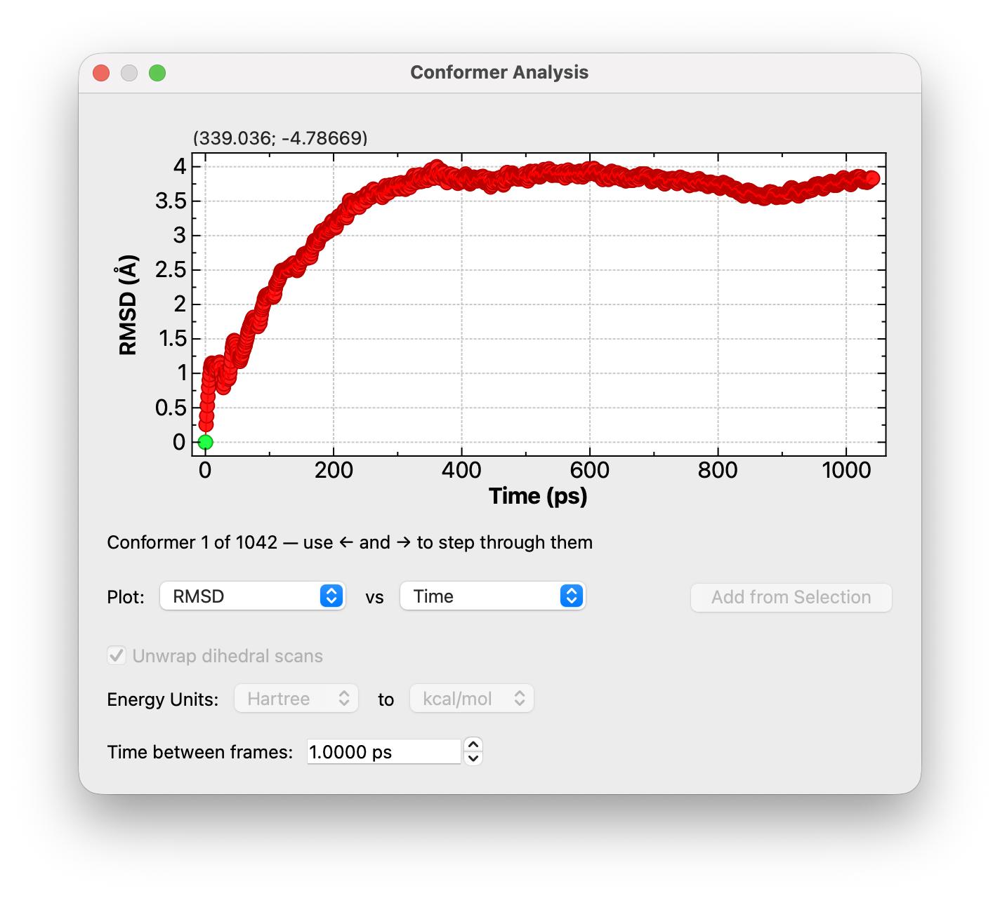
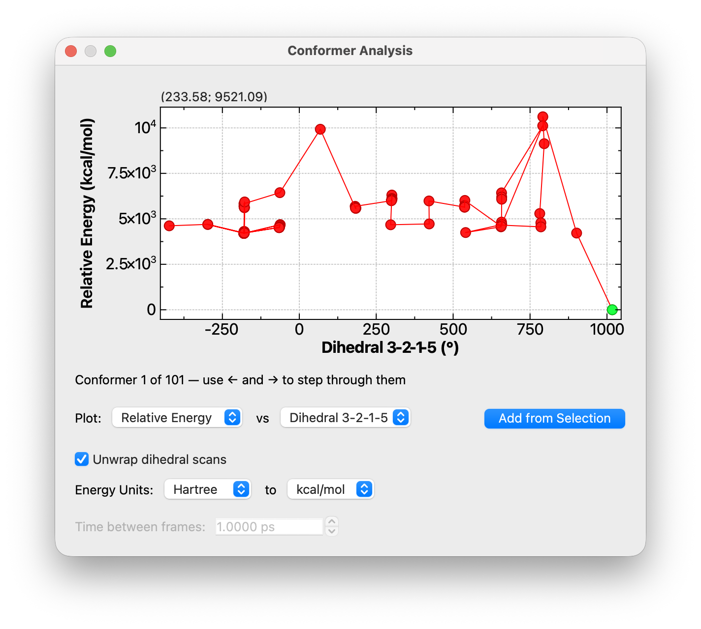

(analyze-conformer-plot)=

# Plotting Conformer and Trajectory Data

```{tip} **New in 2.1**
The conformer plot window has been rewritten in version 2.1. It can now plot any two quantities against each other, including distances, angles and dihedrals, time, temperature and atomic speeds, and you can step through the conformers from the plot.
```


Choose `Analyze` ⇒ `Plot Conformer Data…` to open the **Conformer Analysis** window.



## Choosing What to Plot

The two drop-down menus read as a sentence: **Plot** *(y axis)* **vs** *(x axis)*. Any quantity can go on either axis. By default, Avogadro plots the relative energy against the frame number if the file has energies, or the RMSD against the frame number if it doesn't.

The quantities available depend on what the file contains:

Frame
: The position of the geometry in the file, counting from zero.

Time (ps)
: The elapsed time. Available for trajectories (files with more than one geometry). If the file records when each frame was written, those times are used. Otherwise they're worked out from the **Time between frames** setting.

RMSD (Å)
: The root mean square displacement of the atoms from their positions in the first geometry. See [the formulas below](conformer-plot-formulas).

Relative Energy
: The energy of each geometry relative to the lowest-energy one. Available if the file has energies.

RMS Gradient
: The root mean square gradient (force) on the atoms. Available if the file has gradients.

Mean Speed (Å/ps)
: The average speed of the atoms. Available for trajectories. Error bars show the standard deviation of the atomic speeds, which tells you whether the motion is spread evenly over the atoms or concentrated in a few of them.

Temperature (K)
: The instantaneous temperature from the kinetic energy of the atoms. Available for trajectories of more than one atom.

Distance, Angle and Dihedral
: Any constraints on the molecule are listed automatically, since a relaxed scan usually steps through a constrained coordinate. You can add other coordinates yourself, as described below.

## Following a Distance, Angle or Dihedral

To plot a geometric parameter across the conformers:

1. Select 2, 3 or 4 atoms (for example, with the [Selection Tool](tools-selection-tool)) for a distance, angle or dihedral.
2. Click **Add from Selection**.

The new coordinate is added to both drop-down menus and shown on the x axis. Where the selected atoms are bonded, Avogadro orders them along the bonds, so selecting the four atoms of a torsion gives the dihedral you expect.



Unwrap dihedral scans
: A dihedral jumps from 180° to −180° as it passes through the *anti* position, which breaks up a scan plotted against it. With this option checked (the default), Avogadro removes those 360° jumps so the scan plots as a continuous curve. It only applies when a dihedral is plotted.

## Stepping Through the Conformers

The window always shows which geometry is displayed in the main window, as an orange marker on the plot and as a line such as "Conformer 3 of 12" below it.

- Click on the plot to jump to the nearest point.
- Press <kbd>←</kbd> / <kbd>→</kbd> (or <kbd>↓</kbd> / <kbd>↑</kbd>) to step back or forward one conformer.
- Hold <kbd>Shift</kbd> with the arrow keys, or press <kbd>Page Down</kbd> / <kbd>Page Up</kbd>, to step by 10.
- Press <kbd>Home</kbd> or <kbd>End</kbd> to go to the first or last conformer.

The main window and the [Animation Tool](tools-animation-tool) follow along, so this is a quick way to look at the geometry behind any point on the plot.

## Energy Units

Most files don't say what units their energies are in. When an energy is plotted, the **Energy Units** menus set the units the energies are in (*from*) and the units to show them in (*to*): Hartree, eV, kcal/mol or kJ/mol. If the file does record its energy units, the first menu shows them and can't be changed.

This is the same setting as **Convert Energy Units…** in the conformer properties table (`Analyze` ⇒ `Properties` ⇒ `Conformer Properties…`), so changing it in one place changes it in both.

## Time Between Frames

Speeds, temperatures and times depend on how far apart in time the saved frames are. Few trajectory formats record this: XYZ and SDF files carry no time at all, and a LAMMPS dump records step numbers rather than times. Set **Time between frames** (in picoseconds) to the interval at which your simulation *saved* frames. Avogadro uses the value from the file where there is one, and 1 ps otherwise. Setting it overrides any times recorded in the file.

This setting is only enabled when time, mean speed or temperature is plotted. It's stored with the molecule and shared with the conformer properties table.

(conformer-plot-formulas)=

## How the Values Are Calculated

**RMSD** for geometry $k$ is computed over the $N$ atoms against the first geometry:

$$
\mathrm{RMSD}_k = \sqrt{\frac{1}{N} \sum_{i=1}^{N} \left| \mathbf{r}_i^{(k)} - \mathbf{r}_i^{(0)} \right|^2}
$$

The geometries are *not* superimposed first, so any overall translation or rotation of the molecule counts toward the RMSD.

**Velocities.** If the file includes atomic velocities, they're used directly. Otherwise, Avogadro estimates them from the change in position between neighboring frames:

$$
\mathbf{v}_i^{(k)} = \frac{\mathbf{r}_i^{(k)} - \mathbf{r}_i^{(k-1)}}{\Delta t}
$$

where $\Delta t$ is the time between frames. The first frame uses the difference to the second frame instead. The mean speed is the average of $|\mathbf{v}_i|$ over the atoms.

**Temperature** follows from equipartition, after removing the motion of the center of mass $\mathbf{v}_\mathrm{COM}$:

$$
T = \frac{2K}{N_\mathrm{df}\,k_\mathrm{B}}, \qquad K = \frac{1}{2} \sum_{i=1}^{N} m_i \left| \mathbf{v}_i - \mathbf{v}_\mathrm{COM} \right|^2, \qquad N_\mathrm{df} = 3N - 3
$$

Atomic masses include any isotopes set on the atoms.

:::{warning}
Velocities estimated from saved frames are only as good as the spacing between the frames. If your simulation saved a frame every few hundred steps, the atoms will have changed direction many times between frames, and the estimated speeds and temperature will be much lower than the real ones. Bond constraints during the simulation (e.g., SHAKE) remove degrees of freedom that aren't accounted for here, which also makes the temperature read low. For quantitative work, save velocities from the simulation itself.
:::

## Conformer Properties Table

The conformer properties table (`Analyze` ⇒ `Properties` ⇒ `Conformer Properties…`) lists the same quantities as columns, one row per conformer, so you can sort by them or copy the values elsewhere.


## See Also

- {ref}`optimize-conformers` – Generate conformers with a conformer search
- {ref}`optimize-constraints` – Set up constraints for a relaxed scan
- {ref}`tools-animation-tool` – Play back trajectories
- {ref}`menus-analyze-menu` – Other analysis tools
