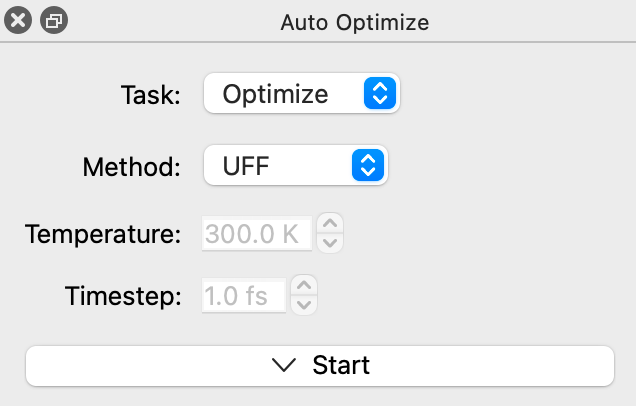
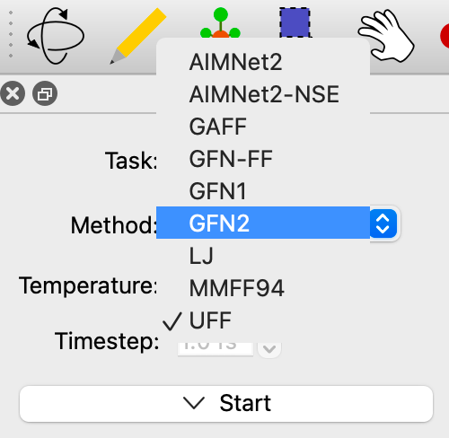

(tools-autoopt-tool)=

# AutoOptimization Tool

Keyboard shortcut: <kbd>Ctrl</kbd>+<kbd>7</kbd>

The **AutoOpt Tool** is used to optimize the geometry of a molecule interactively, including editing or moving atoms.

## Basic Usage

Select a method to optimize the system. Depending on the elements in your
molecule, the total charge on the system, etc. different methods may be available. (For example, not all methods work with crystals and unit cells.) By default both the UFF and Lennard-Jones (LJ) models are available for all systems. Molecules will reoptimize until dE=0 or "Stop" is clicked.

The default force field in Avogadro is UFF (Universal Force Field). UFF can generally reproduce the most structural features across the periodic table. Other methods may provide better geometries for organic molecules (e.g., GAFF or MMFF94) and you can install additional methods as plugins including a wide variety of machine learning (ML) potentials.

For example, in the screenshot above, the `xtb-energy` and `aimnet2` plugins have been installed, in addition to the UFF and LJ methods in Avogadro and the GAFF and MMFF94 methods from Open Babel. To install plugins like these, use `Extensions` ⇒ `Manage Plugins…` and look for the **E** (Energy Models) feature. See {ref}`plugins-manager`.

## See Also

- {ref}`optimize` – Overview of geometry optimization methods in Avogadro
- {ref}`optimize-force-fields` - Overview of different force field methods
- {ref}`optimize-constraints` – Freeze atoms, fix distances, angles, and dihedrals during optimization
- {ref}`plugins-manager` – Installing plugins, including additional energy models
