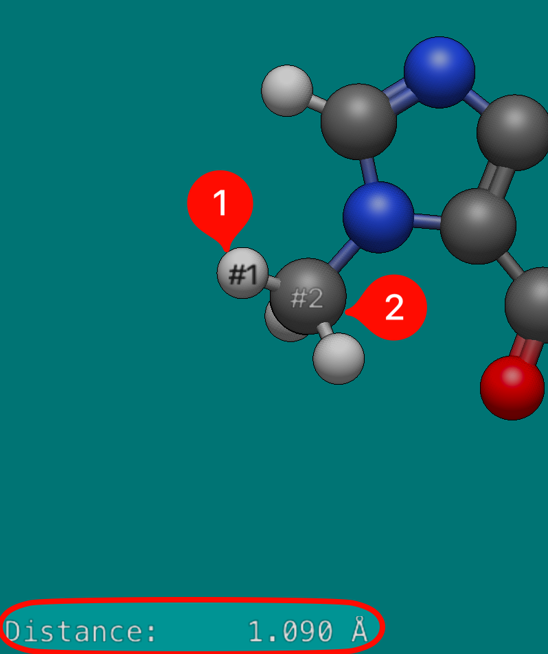
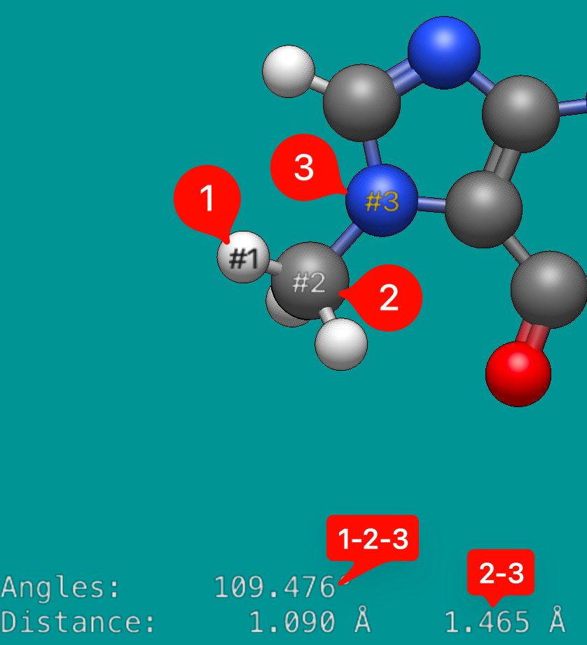
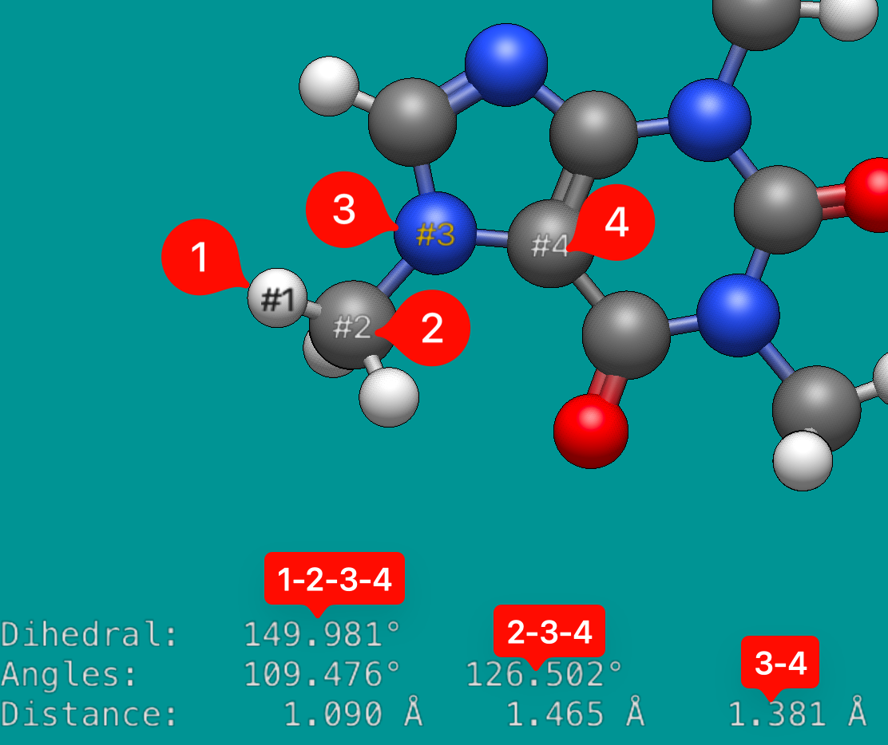
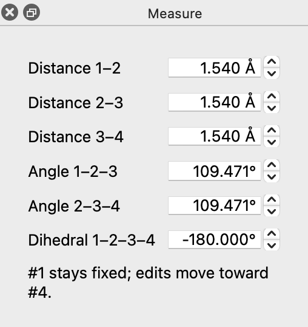

(tools-measure-tool)=

# Measure Tool


Keyboard shortcut: <kbd>Ctrl</kbd>+<kbd>8</kbd>

The measure tool determines bond lengths, angles, and dihedrals. It allows you to select and assess up to four atoms, and to [edit](measure-tool-editing) the values by typing new ones.

As you click on atoms Avogadro will automatically calculate the distances between atoms in a respective order.

For example, the distance between atom 1 and 2 is 1.090 Å \(displayed below\).



Avogadro will also determine the angle between atoms, if at least three atoms have been selected, as well as indicating the distance between atoms 2 and 3.

The second atom is used as the vertex (e.g., atoms 1-2-3 = 109.476°)



If four atoms are selected, a dihedral angle is determined (e.g. 149.981° for atoms 1-2-3-4), as well as the 2-3-4 angle, and the 3-4 distance.



Clicking on an atom will remove it from the list, or double clicking the display will reset the atoms previously selected.

Dragging the mouse (rather than clicking) rotates the view, so you can turn the molecule to reach the atoms you want without switching tools.

(measure-tool-editing)=

## Editing Values

```{tip} **New in 2.1**
Distances, angles and dihedrals can now be edited directly in the Measure tool.
```

The [Tool pane](panes-tool-pane) shows each value as an editable box. Type a new value and press <kbd>Enter</kbd>, or use the arrow buttons, the up and down arrow keys, or the mouse wheel to change it step by step. The atoms move as soon as the edit is applied.



The rows shown depend on how many atoms are picked:

| Atoms picked | Editable values |
| --- | --- |
| 2 | Distance 1–2 |
| 3 | Distance 1–2, Distance 2–3, Angle 1–2–3 |
| 4 | All of the above, plus Distance 3–4, Angle 2–3–4 and Dihedral 1–2–3–4 |

### What Moves

Atom #1 always stays fixed, and an edit moves the atoms toward the last atom picked, as the line below the values reminds you. Avogadro moves as much of the molecule as can move rigidly with that end:

Distance
: The second atom of the pair moves, along with everything bonded to it on its side of the bond. If the two atoms are in separate molecules (for example, a hydrogen-bonded dimer), the whole second molecule moves.

Angle
: Everything on the far side of the bond from the fixed end rotates about the vertex atom. If the two end atoms are in separate molecules, the whole molecule containing the last atom rotates.

Dihedral
: Everything on the far side of the central bond (2–3 for Dihedral 1–2–3–4) rotates about that bond. If atoms #1 and #4 are in separate molecules, the whole molecule containing atom #4 rotates.

Values must stay in a sensible range: distances between 0.5 and 1000 Å, and angles between 0° and 180°. Dihedrals wrap around, from −180° to 180°. An angle edit that would bring the two end atoms closer than 0.5 Å is refused.

Each edit can be undone with `Edit` ⇒ `Undo`. Repeated changes to the same value (for example, holding down an arrow key) are combined into a single undo step.

### When an Edit Is Refused

Some values can't be changed without distorting the molecule. In that case nothing moves, and a message in the Tool pane explains why, for example:

- A bond the angle or dihedral would turn about is part of a ring (for example, bond 2–3 of a dihedral), so the ring would have to be distorted.
- The atoms are connected through the rest of the molecule, but not directly bonded along the chain picked, so there's no part of the molecule that can move on its own. Try the [Manipulate Tool](tools-manipulation-tool) or the {ref}`building-molecules-zmatrix-editor` instead.
- The atoms are in a straight line (or on top of each other), so the angle or dihedral isn't defined.

:::{tip}
After large edits, a quick geometry optimization will clean up the rest of the structure. Use [constraints](optimize-constraints) to hold the values you just set while the rest of the molecule relaxes.
:::

## See Also

- {ref}`tools-bond-centric-manipulation-tool` – Adjust bond lengths and angles interactively
- {ref}`building-molecules-zmatrix-editor` – Edit every distance, angle and dihedral of the molecule in a table
- {ref}`optimize-constraints` – Hold distances, angles and dihedrals fixed during optimization
