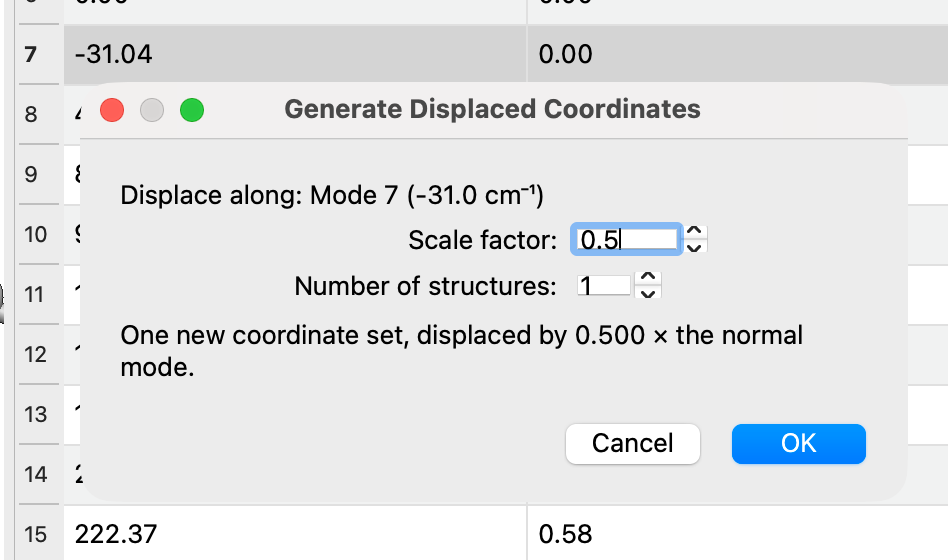

(tutorials-displacing-along-vibrations)=

# Distorting a Structure Along a Vibrational Mode

```{tip} **New in 2.1**
Generating displaced structures from the Vibrational Modes window changed in version 2.1.
```

After a frequency calculation, you sometimes need a structure distorted along one of the vibrational modes. Common reasons include:

- **Removing an imaginary frequency.** If an optimized structure has an imaginary (negative) frequency, it's a saddle point rather than a minimum. Displacing along that mode and reoptimizing usually moves the structure down to the nearby minimum.
- **Starting from a transition state.** Displacing a transition state forward and backward along its imaginary mode gives starting points for optimizing to the reactant and product (a quick alternative to a full IRC calculation).
- **Scanning a mode**, for example to compute the energy or a property along a vibration.

This tutorial shows how to generate the displaced structures and save them.

## 1. Open the Frequency Calculation

Open the output file from a frequency calculation (e.g., Gaussian, ORCA, Q-Chem, or a Molden file). The **Vibrational Modes** window opens automatically. If it doesn't, choose `Analyze` ⇒ `Vibrational Modes…`.

Imaginary frequencies are listed as negative numbers. Click a mode and click **Start Animation** to check that it's the motion you expect. See {ref}`tutorials-viewing-vibrations` for more about this window.

## 2. Generate the Displaced Structures

1. In the Vibrational Modes window, right-click the mode and choose **Generate Displaced Coordinates…**. To displace along a combination of modes, select several rows first (hold <kbd>Ctrl</kbd> or <kbd>Shift</kbd>), then right-click one of them.
2. In the dialog, set:

   Scale factor
   : How far to displace, as a multiple of the normal mode displacement vectors. A negative value displaces in the opposite direction.

   Number of structures
   : `1` gives a single structure at the scale factor. A larger number gives a series of structures spread evenly from −*scale* to +*scale*. With an odd number, the middle structure is the original, undisplaced geometry.

   The dialog summarizes what will be generated.
3. Click **OK**.



The displaced structures are added to the molecule as new conformers, after any it already has, and the first of them is shown in the main window. The original geometry is kept: if the file held only one geometry, it becomes the first conformer.

:::{note}
The size of the normal mode vectors depends on the program that wrote the file, so the same scale factor can give different displacements for different programs. Start small (e.g., 0.2–0.5) and check the structure. Use the [Measure Tool](tools-measure-tool) to check a bond length that the mode changes.
:::

The displaced structures don't carry the vibrational data, since the modes belong to the original geometry. The mode list is empty while a displaced structure is shown, and comes back when you return to the original geometry.

## 3. Look Through the Structures

Step through the structures with `Analyze` ⇒ `Properties` ⇒ `Conformer Properties…` (click a row), or with `Analyze` ⇒ `Plot Conformer Data…` and the arrow keys. The [Animation Tool](tools-animation-tool) plays them as a movie.

## 4. Save the Structure

1. Show the structure you want (e.g., by clicking its row in the conformer table).
2. Save it with `File` ⇒ `Save As…` in a format such as XYZ, or generate an input file from the `Input` menu.

Most formats save only the structure currently shown. To keep all of the structures in one file, save in Avogadro's CJSON format (`.cjson`).

:::{tip}
To remove an imaginary frequency, displace along it, reoptimize the displaced structure, and rerun the frequency calculation to confirm that the imaginary frequency is gone.
:::

## See Also

- {ref}`tutorials-viewing-vibrations` – Viewing and animating vibrations
- {ref}`analyze-conformer-plot` – Stepping through and plotting the structures
- {ref}`menus-input-menu` – Generating input files
