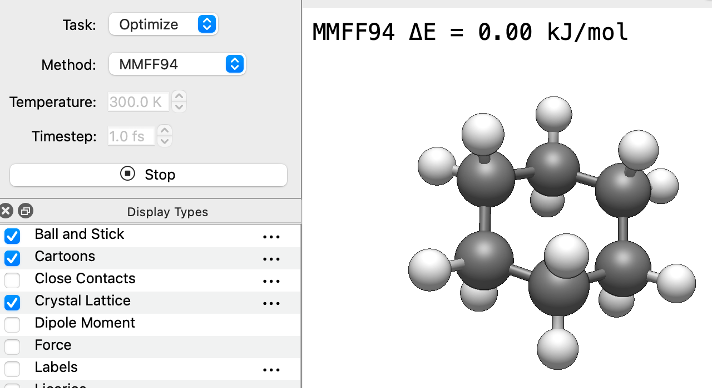

(tutorials-optimizing-while-editing)=

# Optimizing While You Edit

Most people optimize a structure once they've finished building it. The [Auto Optimize Tool](tools-autoopt-tool) instead runs the optimization continuously, so the molecule relaxes as you build and move atoms. Drag an atom out of place and watch the rest of the molecule respond; add a group and watch it settle into position.

## Start Auto Optimize

1. Build or open a molecule. For this example, insert cyclohexane (`Build` ⇒ `Insert` ⇒ `SMILES…` and type `C1CCCCC1`).
2. Choose the Auto Optimize Tool from the toolbar, or press <kbd>Ctrl</kbd>+<kbd>7</kbd>.
3. In the Tool pane, check the settings:
   - **Task:** `Optimize`.
   - **Method:** Avogadro suggests a method that works for the elements in your molecule. UFF works across the periodic table; MMFF94 or GAFF are often better for organic molecules. Methods installed as plugins (including machine-learning potentials) appear here too.
4. Click **Start**.

The molecule relaxes on screen, and the method and the change in energy (ΔE) are shown in the corner of the view. The optimization keeps running until you click **Stop**.

## Edit While It Runs

While the optimization is running:

- **Drag an atom** with the left mouse button to pull it to a new position. Release it and the molecule relaxes around the new position. For example, pull one carbon of cyclohexane out of the ring and watch the rest of the ring follow, then settle again when you let go.
- **Select several atoms first** (e.g., with the [Selection Tool](tools-selection-tool)), then drag with the left mouse button to move them together, or with the right mouse button to rotate them.
- **Drag in empty space** to rotate or zoom the view as usual.

You can also switch to another tool, such as the [Draw Tool](tools-draw-tool) or [Template Tool](tools-template-tool), while the optimization is still running. Each time you add, delete or change atoms or bonds, Auto Optimize picks up the new structure and keeps relaxing it. Switch back to the Auto Optimize Tool to click **Stop**.

:::{tip}
This is a fast way to clean up a structure as you draw it: start Auto Optimize, switch to the Draw Tool, and each new atom or group settles into place as you add it.
:::

## Hold Parts of the Molecule Fixed

Auto Optimize respects frozen atoms and constraints:

- To keep atoms in place, open `Analyze` ⇒ `Properties` ⇒ `Atom Properties…`, select the rows for those atoms, right-click and choose **Freeze Atom**.
- To keep a distance, angle or dihedral at a fixed value, add a constraint. See {ref}`optimize-constraints` and {ref}`tutorials-setting-geometry-values`.

This is useful, for example, to relax a ligand while keeping a metal center or a surface fixed.

## Watch the Molecule Move: Dynamics

Set **Task** to `Dynamics` to run a short molecular dynamics simulation instead of an optimization. Set the **Temperature** (in K) and the **Timestep** (in fs), then click **Start**. Avogadro first relaxes the structure briefly, then lets it move at the chosen temperature. The current temperature is shown in the corner of the view.

This is a quick way to get a feel for how flexible a molecule is, or to shake a structure out of a strained geometry before optimizing it. It isn't meant as a replacement for a production simulation.

:::{note}
The steps of a run are combined into a single undo step, so `Edit` ⇒ `Undo` takes you back to the structure from before you clicked **Start**.
:::

## See Also

- {ref}`tools-autoopt-tool` – Reference for the Auto Optimize Tool
- {ref}`optimize-force-fields` – Choosing a force field
- {ref}`optimize-constraints` – Freezing atoms and constraining values
- {ref}`plugins-manager` – Installing additional methods
