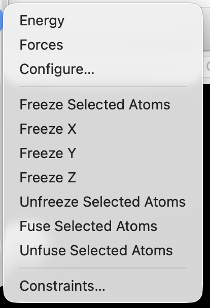
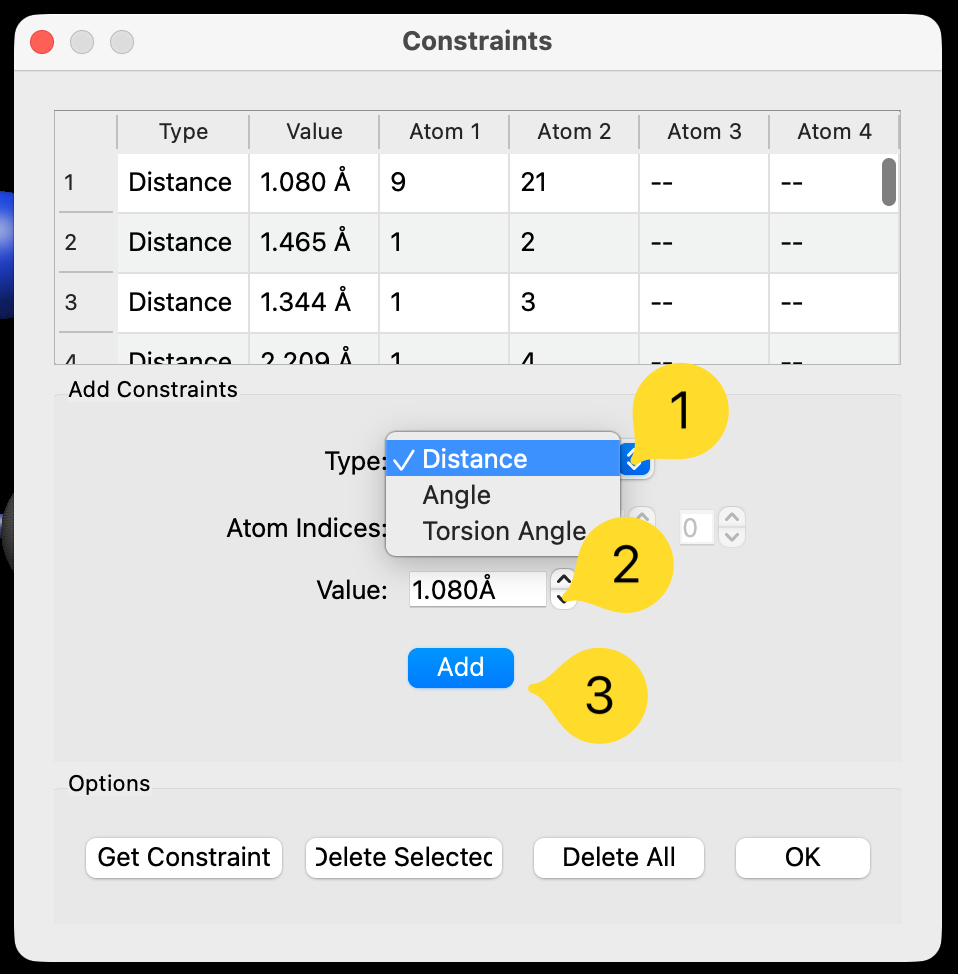
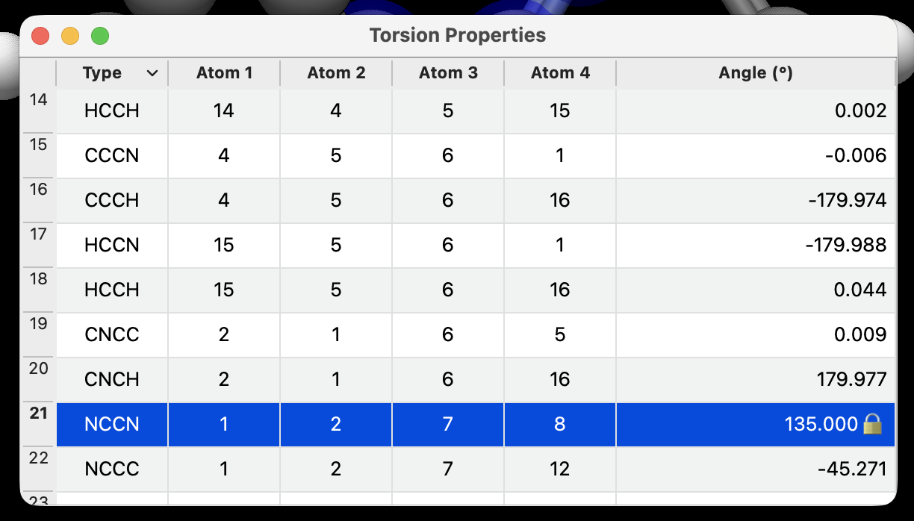
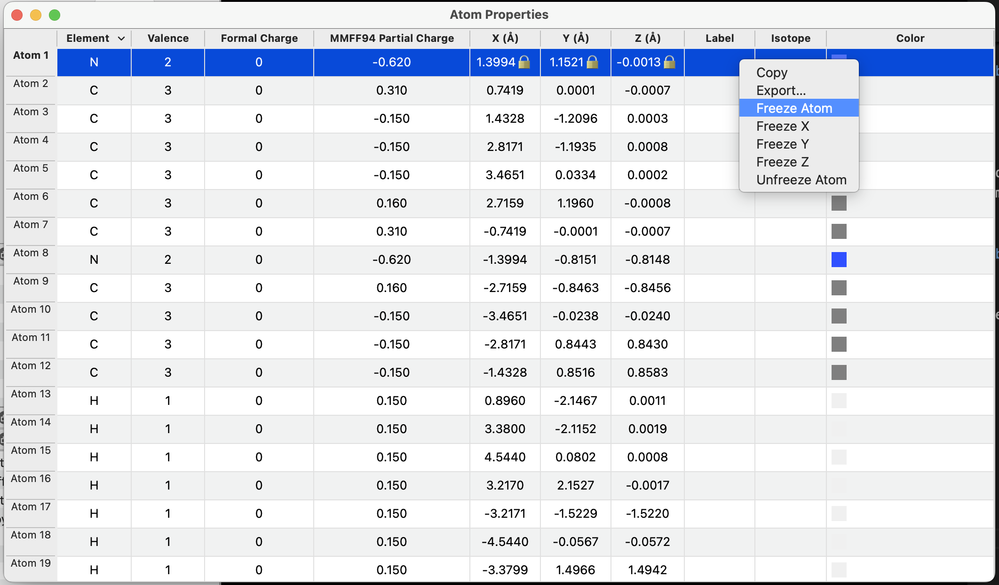

(tutorials-optimizing-with-constraints)=

# Optimizing with Constraints

Often you don't want the *whole* molecule to relax. You might want to keep part of a structure fixed, hold a bond at a particular length, or find the best geometry with a dihedral angle locked at a chosen value. Avogadro does all of these with **constraints**.

This tutorial is organized by task. Each section stands on its own, so jump to the one you need:

- [Keep some atoms from moving](tutorial-constraints-freeze)
- [Optimize only one region of a molecule](tutorial-constraints-region)
- [Hold a bond length, angle, or dihedral at a set value](tutorial-constraints-geometry)
- [Keep a group of atoms rigid while it moves](tutorial-constraints-fuse)
- [Check, change, and remove constraints](tutorial-constraints-remove)

For a reference list of every constraint command, see {ref}`Geometry Constraints<optimize-constraints>`.

:::{tip}
Constraints apply to both <kbd>Extensions</kbd> ⇒ <kbd>Optimize Geometry</kbd> and the interactive [AutoOptimize Tool](tools-autoopt-tool). They also work with every energy method, including the built-in force fields, Open Babel force fields, and energy-model plugins such as xtb or machine-learning potentials.
:::

(tutorial-constraints-freeze)=

## Task 1: Keep Some Atoms from Moving

**Use this when:** you have a molecule on a surface, a ligand in a fixed binding pose, or any part of a structure that must stay exactly where it is.

Freezing an atom fixes its position completely. Frozen atoms do not move at all during optimization.

1. Use the [Selection Tool](tools-selection-tool) to select the atoms you want to keep fixed.
2. Choose <kbd>Extensions</kbd> ⇒ <kbd>Calculate</kbd> ⇒ <kbd>Freeze Selected Atoms</kbd>.

   

3. Choose <kbd>Extensions</kbd> ⇒ <kbd>Optimize Geometry</kbd>.

The frozen atoms stay in place, and the rest of the molecule relaxes around them.

### Freezing Only One Direction

Sometimes an atom should be free to move in some directions but not others. For example, you might want a molecule to stay at a fixed height above a surface while sliding across it.

Select the atoms, then choose <kbd>Extensions</kbd> ⇒ <kbd>Calculate</kbd> ⇒ <kbd>Freeze Z</kbd>. The atoms can still move in X and Y. <kbd>Freeze X</kbd> and <kbd>Freeze Y</kbd> work the same way. Freeze two axes and the atoms can only move along a line.

:::{note}
The X, Y, and Z axes are the Cartesian axes of the molecule's coordinates, not the directions on your screen. For a surface slab, build or orient the slab so the surface normal lies along Z.
:::

(tutorial-constraints-region)=

## Task 2: Optimize Only One Region of a Molecule

**Use this when:** you have edited one part of a large structure (for example, a substituent, a binding site, or a defect) and want to clean up just that part.

<kbd>Optimize Geometry</kbd> always optimizes the whole molecule, even if some atoms are selected. To optimize only one region, **freeze everything else**:

1. Select the atoms you want to optimize.
   - To grow the selection outward, use <kbd>Select</kbd> ⇒ <kbd>Enlarge Selection</kbd>. Each time you use it, the selection grows to include all atoms within 2.5 Å beyond its current outer edge.
2. Choose <kbd>Select</kbd> ⇒ <kbd>Invert Selection</kbd>. Now everything *except* your region is selected.
3. Choose <kbd>Extensions</kbd> ⇒ <kbd>Calculate</kbd> ⇒ <kbd>Freeze Selected Atoms</kbd>.
4. Choose <kbd>Extensions</kbd> ⇒ <kbd>Optimize Geometry</kbd>.

Only your region moves.

:::{tip}
Include a shell of neighboring atoms in the region you optimize, not just the atoms you edited. If the boundary is right next to your change, the atoms there can't adjust and the geometry will be strained.
:::

When you're done, select all atoms (<kbd>Select</kbd> ⇒ <kbd>Select All</kbd>) and choose <kbd>Extensions</kbd> ⇒ <kbd>Calculate</kbd> ⇒ <kbd>Unfreeze Selected Atoms</kbd> so later optimizations can move them again.

(tutorial-constraints-geometry)=

## Task 3: Hold a Bond Length, Angle, or Dihedral at a Set Value

**Use this when:** you want the best geometry with one internal coordinate held fixed. Examples include:

- a metal–ligand distance taken from a crystal structure
- an approximate transition-state geometry with a partly formed bond
- a molecule locked into a particular conformation

In this example we'll look at the conformations of butane by holding the central C–C–C–C dihedral angle at different values.

### Build Butane

Choose <kbd>Build</kbd> ⇒ <kbd>Insert</kbd> ⇒ <kbd>SMILES…</kbd>, enter `CCCC`, and click OK. (See [Building with SMILES](building-molecules-smiles) for details.)

### Option A: The Constraints Dialog

1. With the [Selection Tool](tools-selection-tool), select the four carbon atoms in order along the chain.
2. Choose <kbd>Extensions</kbd> ⇒ <kbd>Calculate</kbd> ⇒ <kbd>Constraints…</kbd>.

   

   Because four atoms are selected, the dialog chooses **Torsion Angle** and fills in the atom numbers and the current dihedral angle for you. (With two atoms selected it chooses **Distance**; with three it chooses **Angle**, with the middle atom as the vertex.)

3. Change **Value** to `0` (the eclipsed conformation) and click **Add**. The constraint appears in the list at the top of the dialog.
4. Click **OK**, then choose <kbd>Extensions</kbd> ⇒ <kbd>Optimize Geometry</kbd>.

The molecule rotates to a 0° dihedral angle, and everything else (C–H bonds, angles, and the methyl rotations) relaxes around it.

**The value you set doesn't have to match the current geometry.** The optimization moves the atoms to reach it. This is the easiest way to set a precise bond length or angle and still get a sensible structure around it.

:::{note}
Atom numbers in the Constraints dialog start at **1**, matching the **Index** atom [labels](tools-label-tool) and the numbering in the [Atom Properties](panes-properties-atom) table. You can also type atom numbers directly instead of selecting atoms first.
:::

### Option B: The Property Tables

The property tables are a faster way to constrain a coordinate at its *current* value.

1. Choose <kbd>Analyze</kbd> ⇒ <kbd>Properties</kbd> ⇒ <kbd>Torsion Properties…</kbd> (or <kbd>Bond Properties…</kbd> or <kbd>Angle Properties…</kbd>).
2. Find the C–C–C–C row. If you want a different value, edit it in the table first and press Enter. The molecule updates to match.
3. Right-click the row and choose <kbd>Constrain Torsion</kbd>. A 🔒 appears next to the value.

   

4. Optimize the molecule.

### Try It: A Simple Conformational Comparison

Repeat the procedure with the dihedral angle set to 0°, 60°, 120°, and 180°. After each optimization, compare the energies with <kbd>Extensions</kbd> ⇒ <kbd>Calculate</kbd> ⇒ <kbd>Energy</kbd>. The anti (180°) and gauche (about 60°) conformations should be lower in energy than the eclipsed ones (0° and 120°).

Before you set a new value for the same dihedral, delete the old constraint (see [Task 5](tutorial-constraints-remove)). Otherwise the two constraints pull against each other.

:::{admonition} How precise are constraints?
:class: note

Frozen atoms (Task 1) are exact: they do not move at all.

Distance, angle, and dihedral constraints work differently. Each one acts like a very stiff spring pulling the coordinate toward its target. After optimization the value is usually very close to the target, but not always exact to the last decimal place, especially if the rest of the molecule pulls strongly against it.

The energy reported for a constrained structure includes a small contribution from these springs. If you need exact energies for a comparison like the one above, use the constrained structures as starting points for a constrained optimization in a quantum chemistry program.
:::

(tutorial-constraints-fuse)=

## Task 4: Keep a Group of Atoms Rigid While It Moves

**Use this when:** a group of atoms should keep its shape but still be able to move as a unit. Examples include a metal cluster, a nanoparticle, or a rigid ligand you want to dock against something else.

This is different from freezing: frozen atoms can't move at all, while fused atoms can translate and rotate together.

1. Select the atoms in the group.
2. Choose <kbd>Extensions</kbd> ⇒ <kbd>Calculate</kbd> ⇒ <kbd>Fuse Selected Atoms</kbd>.
3. Optimize.

The group moves as a single piece while the rest of the system relaxes around it.

Fusing works by adding a distance constraint between every pair of selected atoms, so all of those constraints will appear in the Constraints dialog. To undo it, select the same atoms and choose <kbd>Unfuse Selected Atoms</kbd>.

:::{tip}
Fusing *n* atoms creates *n*(*n*−1)/2 constraints, which is about 5,000 for a 100-atom group. For very large groups, freezing is faster if the group doesn't actually need to move.
:::

(tutorial-constraints-remove)=

## Task 5: Check, Change, and Remove Constraints

Constraints stay with the molecule until you remove them. If an optimization doesn't behave as you expect, first check whether any constraints are left over from earlier work.

### Finding Existing Constraints

- **Frozen atoms** show a 🔒 next to their X, Y, and Z coordinates in <kbd>Analyze</kbd> ⇒ <kbd>Properties</kbd> ⇒ <kbd>Atom Properties…</kbd>.

  

- **Distance, angle, and dihedral constraints** are listed in <kbd>Extensions</kbd> ⇒ <kbd>Calculate</kbd> ⇒ <kbd>Constraints…</kbd>. Click a row to select the atoms it involves in the 3D view. They also show a 🔒 in the Bond, Angle, and Torsion Properties tables.

### Removing Constraints

| To remove… | Do this |
|---|---|
| Frozen atoms | Select them, then <kbd>Extensions</kbd> ⇒ <kbd>Calculate</kbd> ⇒ <kbd>Unfreeze Selected Atoms</kbd>. To unfreeze all atoms, select all atoms first. |
| One distance, angle, or dihedral constraint | In the Constraints dialog, click the row and choose **Delete Selected**. Or right-click the row in a property table and choose **Remove Constraint**. |
| All distance, angle, and dihedral constraints | In the Constraints dialog, choose **Delete All**. |
| A fused group | Select the atoms, then <kbd>Unfuse Selected Atoms</kbd>. |

:::{important}
**Delete All** in the Constraints dialog does *not* unfreeze atoms. Frozen atoms are stored separately. Use <kbd>Unfreeze Selected Atoms</kbd> for those.
:::

### Saving Constraints

Frozen atoms and constraints are saved in Avogadro's native **CJSON** format (`.cjson`), so they're still there when you reopen the file. Most other formats (XYZ, PDB, MOL2, SDF, etc.) have no way to store them, so they're lost when you save in those formats.

## Troubleshooting

**"I selected some atoms, but Optimize Geometry moved everything."**
: Selecting atoms doesn't limit the optimization. Freeze the atoms you want to keep fixed. See [Task 2](tutorial-constraints-region).

**"Atoms moved that I didn't expect to move."**
: Check the Constraints dialog and Atom Properties table for constraints left over from earlier work. See [Task 5](tutorial-constraints-remove).

**"My constrained bond ended up a little off from the value I entered."**
: Distance, angle, and dihedral constraints are very stiff springs, not exact locks. See *How precise are constraints?* in [Task 3](tutorial-constraints-geometry). If you need an exact position, freeze the atoms instead.

**"The Constraints dialog's Add button does nothing."**
: Check that the atom numbers are all different and within the number of atoms in the molecule, and that a distance isn't set to zero.

## See Also

- {ref}`Geometry Constraints<optimize-constraints>`: reference for all constraint commands
- [AutoOptimize Tool](tools-autoopt-tool): interactive optimization that also respects constraints
- {ref}`Force Fields<optimize-force-fields>`: choosing an energy method
