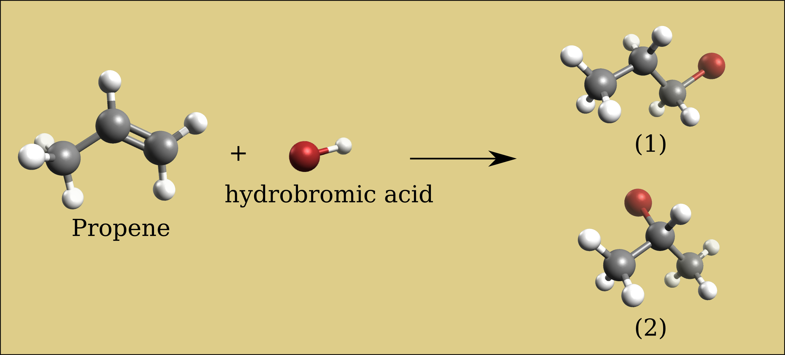
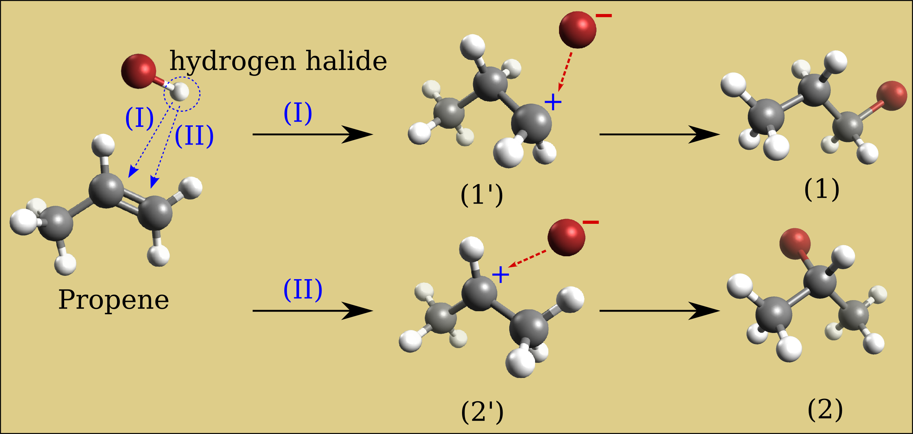

# Markovnikov's Rule

Investigate the stability of reactions using Markovnikov's rule.

## Task

Build a propene molecule and optimize its geometry. Compare the relative energies for adding HBr across the carbon-carbon double bond, with the bromine on either the 1-carbon or the 2-carbon. Which of these two bromopropane compounds will be the major product of the addition of HBr to propene (hydrobromination)?

## Solution

Results of relative energies expressed in kJ/mol (need confirmation in literature).

| Force field | Intermediate primary carbocation (1') | Intermediate secondary carbocation (2') | 1-bromopropane (1) | 2-bromopropane (2) |
| ----------- | ----------- | ------------- | ---------- | ---------- |
| Ghemical    | -2.24       | -2.06         | -2.39      | -1.87 |
| MMFF94      | -9.88       | -3.84         | -8.96      | +2.70 |
| UFF         | +4.05       | +3.63         | +4.15      | +4.86 |

Considering the UFF data, the secondary carbocation intermediate (2') requires less energy than the primary carbocation intermediate (1') (3.6 vs. 4.0 kJ/mol, respectively), so compound (2) will be the major product. This is Markovnikov’s rule: “the major product of the addition of HX (where X is some atom more electronegative than H, the bromine in our case) to an alkene (here the propene) has the hydrogen atom in the less substituted position and X in the more substituted position”. A radical mechanism that avoids the carbocation intermediate, such as in the presence of dialkyl peroxides, reverses the result, and compound (1) becomes the major product (anti-Markovnikov addition).

## See also

[Alkene Isomers](alkene_isomers)

## Further reading

[Markovnikov's rule (wikipedia)](https://en.wikipedia.org/wiki/Markovnikov's_rule)
